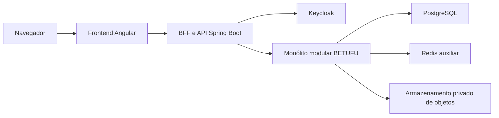

<div align="center">

# BETUFU

**Palpites esportivos universitários com créditos exclusivamente virtuais.**

</div>

> A BETUFU é um projeto independente, sem vínculo, endosso, integração ou representação oficial da Universidade Federal de Uberlândia (UFU). Seus créditos são exclusivamente virtuais, não possuem valor monetário e não podem ser convertidos em dinheiro ou prêmio econômico.

<p align="center">
  
  
  
  
</p>

## Status atual

A BETUFU está em desenvolvimento ativo. A fundação técnica e os fluxos de contas, perfil, matrícula por HMAC e operações governadas já possuem implementação e validação automatizada. A experiência esportiva do piloto está em construção; odds, palpites, créditos, liquidação, rankings, grupos e chat pertencem às fases posteriores do roadmap.

O repositório contém:

- backend Java com Spring Boot, Spring Modulith, Spring Security, JPA e Flyway;
- frontend Angular com TypeScript, Signals, cliente OpenAPI gerado e testes Vitest/Playwright;
- PostgreSQL, Redis, Keycloak, SeaweedFS e Mailpit para o ambiente local;
- scripts governados de inicialização, validação, geração de contrato e reset local;
- testes unitários, de integração, arquitetura, contrato e navegador.

O ponto corrente, as verificações executadas e as pendências estão registrados em [Estado atual do projeto](.planning/STATE.md).

## Visão

A BETUFU pretende tornar competições universitárias mais envolventes por meio de uma experiência social de palpites esportivos pré-jogo, transparente e orientada à integridade. O catálogo é genérico para várias competições e edições; a Olimpíada Universitária UFU 2026 é o primeiro caso real planejado. No MVP, a operação esportiva detalhada começa por eventos de confronto direto com fontes e resultados confiáveis.

O projeto separa descoberta pública de participação competitiva: visitantes poderão acompanhar informações esportivas publicadas sem criar conta, enquanto os recursos competitivos dependerão das regras de elegibilidade da BETUFU. A autenticação é própria da plataforma por meio do Keycloak; não há login, SSO ou conta oficial da UFU.

## Jornada do usuário no MVP

1. Visitar competições, edições, agenda, organizações, equipes, atletas, eventos e resultados publicados.
2. Criar uma conta BETUFU, verificar o e-mail e completar o perfil público mínimo.
3. Registrar voluntariamente a matrícula UFU para a regra de elegibilidade do MVP, sem envio de comprovante documental.
4. Registrar palpites simples pré-jogo com créditos virtuais, acompanhar resultados e participar do ranking ou de grupos privados quando as fases correspondentes forem entregues.

## Escopo do MVP

- Navegação pública por um catálogo genérico de competições, edições, agenda, organizações, equipes, atletas, eventos e resultados.
- Contas BETUFU, perfis públicos mínimos e registro voluntário da matrícula representada por HMAC versionado.
- Operação escopada de catálogo esportivo, elencos, eventos, fontes e resultados por papéis delimitados.
- Odds automáticas e explicáveis, baseadas em Elo por modalidade e categoria, com histórico de versões.
- Palpites simples pré-jogo, créditos virtuais, saldo auditável e liquidação idempotente.
- Ranking UFU vitalício, grupos privados, conquistas e chat persistido por partida com moderação.
- Experiência web responsiva para navegadores móveis e desktop.

## Fora do escopo do MVP

- Dinheiro real, depósitos, saques, compra, venda, transferência ou conversão de créditos.
- Prêmios econômicos, recargas, bônus recorrentes, missões ou mecanismos de recuperação de saldo.
- Apostas ao vivo, múltiplas ou mercados criados por usuários.
- Aplicativos nativos para Android e iOS.
- Login, SSO, integração, vínculo, endosso ou representação oficial da UFU.
- Verificação documental da matrícula ou armazenamento de comprovantes no MVP.
- Motores completos para provas com vários competidores, estatísticas específicas por modalidade e escalações por partida.
- Microsserviços, Kafka e Kubernetes.

## Stack técnica

<p>
  
  
  
  
  
</p>

- **Backend:** Java 25, Spring Boot 4.1, Spring Modulith, Spring Security, Spring Data JPA, Flyway e Maven.
- **Frontend:** Angular 22, TypeScript 6, Signals, RxJS, Vitest e Playwright.
- **Contrato:** OpenAPI como fonte do cliente Angular gerado de forma determinística.
- **Dados e sessão:** PostgreSQL 18 como fonte autoritativa e Redis como infraestrutura auxiliar.
- **Identidade:** Keycloak com fluxo OIDC/BFF e sessão mantida no servidor.
- **Objetos e desenvolvimento local:** SeaweedFS com contrato compatível com S3 e Mailpit para e-mail local.

## Arquitetura



O navegador acessa o frontend Angular, enquanto o BFF executa o fluxo OIDC e mantém tokens fora do browser. O backend é um monólito modular: os módulos permanecem no mesmo processo, mas suas fronteiras são verificadas por Spring Modulith e ArchUnit.

PostgreSQL é a autoridade para dados persistentes. Flyway controla a evolução do schema e migrations aplicadas não são editadas. Redis atende necessidades auxiliares de sessão e operação; o armazenamento de objetos permanece atrás de um contrato privado, sem exposição direta de chaves internas ao navegador.

## Privacidade, autorização e integridade

- Perfis e APIs públicas usam listas explícitas de campos permitidos e não serializam entidades diretamente.
- A matrícula é uma entrada transitória: o backend normaliza, calcula um HMAC versionado e não conserva o número bruto consultável.
- A coincidência de HMAC não comprova vínculo oficial, titularidade ou legitimidade esportiva.
- Administradores de competição precisam possuir o papel correto e o `scopeRef` exato da competição persistida; o nome do papel isoladamente não concede acesso global.
- Dados esportivos nascem em rascunho e só se tornam públicos após publicação explícita.
- Publicações e resultados confirmados preservam versões históricas; correções criam novas versões em vez de sobrescrever fatos anteriores.
- No MVP, a mesma pessoa autorizada pode registrar e confirmar um resultado, mas os atores e instantes permanecem separados para permitir uma política futura de duas pessoas.
- O vínculo de atleta não bloqueia palpites no MVP. Administradores gerais continuam impedidos de apostar, e administradores de competição permanecem impedidos no próprio escopo.
- Créditos e palpites futuros deverão usar transações, histórico imutável e operações idempotentes.

## Roadmap do produto

1. **Fundação Segura da Plataforma — concluída:** base modular, ambiente local, observabilidade, segurança e tracer técnico.
2. **Contas, Verificação e Operações Governadas — concluída:** identidade BETUFU, perfil, matrícula por HMAC e controles operacionais.
3. **Experiência Esportiva do Piloto — em desenvolvimento:** catálogo genérico, organizações, equipes, atletas, elencos, agenda, eventos e resultados.
4. **Mercados Pré-jogo e Odds Transparentes — planejada:** odds automáticas, explicáveis e governadas.
5. **Créditos Virtuais e Palpites Protegidos — planejada:** registros pré-jogo com consistência e segurança.
6. **Resultados Confirmados, Rankings e Grupos — planejada:** liquidação, classificação, grupos e conquistas.
7. **Comunidade Moderada e Prontidão do Piloto — planejada:** chat por evento, moderação e preparação operacional.

## Desenvolvimento local

### Pré-requisitos

- Java 25;
- Maven 3.9.16;
- Node.js e npm 10.9.8;
- Docker com Docker Compose.

As configurações locais incluem segredos de desenvolvimento e devem ser preparadas conforme os contratos do repositório, sem registrar valores reais no Git.

### Infraestrutura

```powershell
node scripts/dev.mjs up daily
node scripts/dev.mjs ps
node scripts/dev.mjs logs postgres
node scripts/dev.mjs stop
```

O profile `daily` sobe os serviços usados no desenvolvimento cotidiano. O profile `full` inclui a composição integrada completa e deve ser usado somente quando a validação correspondente for necessária.

Para inspecionar o reset local sem remover recursos:

```powershell
node scripts/reset-local.mjs
```

O modo padrão é um *dry-run*: ele apenas mostra o que seria removido. A execução material do reset exige `--apply` e confirmação explícita.

### Backend

```powershell
node scripts/maven.mjs -f backend/pom.xml verify
```

O wrapper mantém a versão aprovada do Maven e executa as suítes unitárias e de integração do backend.

### Frontend

```powershell
npm --prefix frontend run start
npm --prefix frontend run test -- --watch=false
npm --prefix frontend run build
```

### Contrato e validações estáticas

```powershell
npm --prefix frontend run generate:api:check
node --test scripts/*.test.mjs
```

Os comandos acima verificam, respectivamente, o cliente derivado do OpenAPI e os contratos estáticos governados do repositório.

## Documentação de referência

- [Visão e decisões do produto](.planning/PROJECT.md)
- [Requisitos do MVP](.planning/REQUIREMENTS.md)
- [Roadmap e ordem das fases](.planning/ROADMAP.md)
- [Estado corrente e evidências](.planning/STATE.md)

## Licença

A licença do projeto ainda não foi definida. Nenhuma licença de uso, cópia, modificação ou distribuição é concedida implicitamente por este repositório.

## Aviso institucional

BETUFU é uma iniciativa independente e não oficial. Qualquer uso de referências a competições universitárias ou à UFU ocorre apenas para contextualizar o piloto planejado e não implica autorização, parceria, afiliação ou representação institucional. Um eventual lançamento público dependerá de revisão jurídica, política de privacidade e definições operacionais adequadas.
