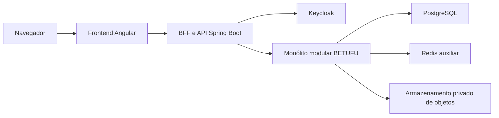

# BETUFU

**Palpites esportivos universitários com créditos exclusivamente virtuais.**

> A BETUFU é um projeto independente, sem vínculo, endosso, integração ou representação oficial da Universidade Federal de Uberlândia (UFU). Seus créditos são exclusivamente virtuais, não possuem valor monetário e não podem ser convertidos em dinheiro ou prêmio econômico.

  
  
  
  

## Status atual

A BETUFU está em planejamento aprovado. Este repositório ainda não contém uma aplicação, API, banco de dados, ambiente local ou fluxo de uso executável. As sete fases do MVP permanecem sem implementação; a primeira fase possui 28 itens de trabalho aprovados, ainda não executados.

Assim, tudo o que aparece nas seções **Visão**, **Escopo**, **Arquitetura** e **Roadmap** descreve a direção planejada do produto — não uma capacidade disponível hoje.

## Visão

A BETUFU pretende tornar uma edição das Olimpíadas UFU mais envolvente por meio de uma experiência social de palpites esportivos pré-jogo, transparente e orientada à integridade. O piloto planejado começa por confrontos diretos que disponham de tabelas e resultados confiáveis.

O projeto separa descoberta pública de participação competitiva: qualquer visitante poderá acompanhar informações esportivas públicas, enquanto apostas e ranking UFU serão reservados a estudantes com vínculo UFU validado. A autenticação será da própria BETUFU; não haverá login, SSO ou conta oficial da UFU.

## Jornada planejada do usuário

1. Visitar competições, agenda, equipes, partidas e resultados públicos.
2. Criar uma conta BETUFU e completar o perfil com apelido e equipe favorita.
3. Solicitar, de forma voluntária, a verificação do vínculo UFU para se tornar elegível aos recursos competitivos.
4. Registrar um palpite simples pré-jogo com créditos virtuais, acompanhar o resultado e participar do ranking ou de grupos privados.

## Escopo planejado do MVP

- Navegação pública por competições, agenda, equipes, partidas e resultados.
- Contas BETUFU, perfis públicos mínimos e verificação voluntária de vínculo UFU.
- Operação de equipes, elencos, partidas, mercados pré-jogo e resultados por papéis delimitados.
- Odds automáticas e explicáveis, baseadas em Elo por modalidade e categoria, com histórico de versões.
- Palpites simples pré-jogo, créditos virtuais, saldo auditável e liquidação idempotente.
- Ranking UFU vitalício, grupos privados, conquistas e chat persistido por partida com moderação.
- Experiência web responsiva para navegadores móveis e desktop.

## Fora do escopo do MVP

- Dinheiro real, depósitos, saques, compra, venda, transferência ou conversão de créditos.
- Prêmios econômicos, recargas, bônus recorrentes, missões ou mecanismos de recuperação de saldo.
- Apostas ao vivo, múltiplas ou mercados criados por usuários.
- Aplicativos nativos para Android e iOS.
- Login, SSO, integração, vínculo, endosso ou representação oficial da UFU.
- Microsserviços, Kafka e Kubernetes.

## Stack-alvo (planejada)

  
  
  
  
  

A arquitetura-alvo prevê Angular e TypeScript no frontend, Java 25 com Spring Boot 4.1 e Maven no backend, PostgreSQL 18 como fonte oficial de dados e Keycloak para identidade. A composição foi definida para um monólito modular; ela ainda não foi implementada neste repositório.

## Arquitetura planejada

O navegador deverá acessar o frontend, enquanto o BFF planejado fará o fluxo OIDC e manterá tokens e sessão no servidor. O monólito modular concentrará regras de perfil, verificação, esportes, odds, palpites, ledger, liquidação, rankings, chat, moderação e auditoria. PostgreSQL será a fonte autoritativa; Redis terá papel auxiliar, e comprovantes temporários deverão permanecer em armazenamento privado.

## Privacidade e integridade planejadas

- Perfis públicos deverão expor somente dados permitidos, como apelido, equipe favorita, posição e conquistas.
- A verificação UFU deverá usar comprovante em área privada, acesso temporário e auditado e exclusão após a decisão final.
- A matrícula deverá ser normalizada e representada internamente por HMAC, sem manter o número original consultável.
- Créditos deverão ser registrados em ledger imutável; correções usarão novos lançamentos, sem apagar histórico.
- Aposta, débito e versão aceita da odd deverão ser gravados na mesma transação.
- Resultados e exceções de odds deverão exigir atuação de administradores distintos, com auditoria e controles adicionais.
- Atletas e administradores deverão enfrentar restrições de conflito de interesse antes de registrar palpites.

## Roadmap do produto

1. **Fundação Segura da Plataforma** — base modular, observável e segura.
2. **Contas, Verificação e Operações Governadas** — identidade BETUFU, vínculo UFU e controles operacionais.
3. **Experiência Esportiva do Piloto** — confrontos diretos, equipes e elencos das Olimpíadas UFU.
4. **Mercados Pré-jogo e Odds Transparentes** — odds automáticas, explicáveis e controladas.
5. **Créditos Virtuais e Palpites Protegidos** — registros pré-jogo com consistência e segurança.
6. **Resultados Confirmados, Rankings e Grupos** — liquidação, classificação e conquistas.
7. **Comunidade Moderada e Prontidão do Piloto** — chat por partida e preparação operacional da experiência pública.

## Documentação de referência

- [Visão e decisões do produto](.planning/PROJECT.md)
- [Requisitos do MVP](.planning/REQUIREMENTS.md)
- [Roadmap de alto nível](.planning/ROADMAP.md)
- [Estado atual do projeto](.planning/STATE.md)

## Desenvolvimento local

O desenvolvimento local ainda não está disponível: não há código-fonte, arquivos de configuração, dependências ou comandos de instalação, execução, compilação e testes no repositório. Essas instruções serão documentadas somente quando a base técnica existir.

## Licença

A licença do projeto ainda não foi definida. Não há licença concedida por este repositório neste estágio.

## Aviso institucional

BETUFU é uma iniciativa independente e não oficial. Qualquer uso de referências a competições universitárias ou à UFU ocorre apenas para contextualizar o piloto planejado e não implica autorização, parceria, afiliação ou representação institucional. Um eventual lançamento público dependerá de revisão jurídica, política de privacidade e definições operacionais adequadas.
